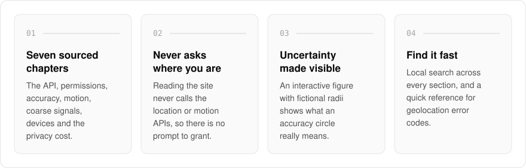
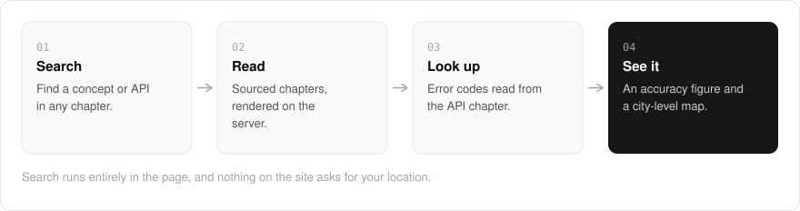

  <picture>
    <source media="(prefers-color-scheme: dark)" srcset=".github/assets/hero-dark.png">
    
  </picture>

<h1 align="center">locate.me.at</h1>

<strong>Browser geolocation, explained.</strong>

  
  
  

  <a href="https://locate.me.at">Website</a> ·
  <a href="#features">Features</a> ·
  <a href="#how-it-works">How it works</a> ·
  <a href="#screenshots">Screenshots</a> ·
  <a href="#built-with">Built with</a>

Browser location looks simple: one prompt, one coordinate. In practice it is an uncertain radius, a permission model and a privacy cost that quick demos skip. I built locate.me.at as an educational field guide to browser geolocation and the location-adjacent web APIs, for developers who want to use them carefully: how it works, where it breaks, and what it gives away. Reading it never calls the location or motion APIs, and visitors are never located.

  <picture>
    <source media="(prefers-color-scheme: dark)" srcset=".github/assets/overview-dark.svg">
    
  </picture>

## Why locate.me.at

| The usual geolocation demo | locate.me.at |
| --- | --- |
| Asks for your location on load | Never requests a position, so there is nothing to grant |
| Shows a pin and a number | Explains what the accuracy radius actually means |
| Covers the happy path | Chapters on permissions, failure codes and the privacy cost |
| Unsourced compatibility claims | Sourced chapters, checked against primary sources |

## Features

- **Seven sourced chapters**: the Geolocation API, permissions and secure context, accuracy, orientation and motion, coarse signals, devices (phones, GPS trackers, Bluetooth tags, vehicles, laptops), and the privacy cost.
- **Location sources, with honest status**: the landing page lists every location source as shipped, compatible, planned, without a public API, or documented only.
- **Local reference search**: find a concept or API across every section, entirely in the page.
- **Error quick reference**: look up a geolocation error code from the homepage, read straight from the API chapter.
- **An accuracy illustration**: an interactive figure with fictional radii that makes location uncertainty tangible without using your device.
- **A worked map example**: a small MapLibre map that displays known, city-level coordinates from a PMTiles archive.
- **No location prompt**: the site never requests a visitor's position, so there is no permission to grant.

## How it works

  <picture>
    <source media="(prefers-color-scheme: dark)" srcset=".github/assets/flow-dark.svg">
    
  </picture>

The chapters are TypeScript data rendered on the server, with no MDX pipeline, and search runs entirely in the page across every section. The error quick reference reads straight from the API chapter, so the homepage and the reference cannot drift apart. The map shows known, city-level coordinates from a PMTiles archive, and nothing on the site asks for your location.

## Screenshots

<table>
  <tr>
    <td width="50%"><picture><source media="(prefers-color-scheme: dark)" srcset=".github/assets/hero-dark.png"></picture> The landing page, from the top.</td>
    <td width="50%"><picture><source media="(prefers-color-scheme: dark)" srcset=".github/assets/reference-dark.png"></picture> Reference: the browser location chapters, with search.</td>
  </tr>
</table>

## Built with

  
  
  
  
  

- Next.js 16 (App Router), React 19, TypeScript
- Tailwind CSS 4
- MapLibre GL with PMTiles vector tiles
- Server-rendered TypeScript content (no MDX pipeline)

## Part of the me.at family

locate.me.at is one of my [`*.me.at`](https://me.at) apps. They share one design system, account, and app shell. Development happens in a private monorepo; this repository is the project's public-facing home.

## License

Source-available. See [LICENSE](LICENSE).
