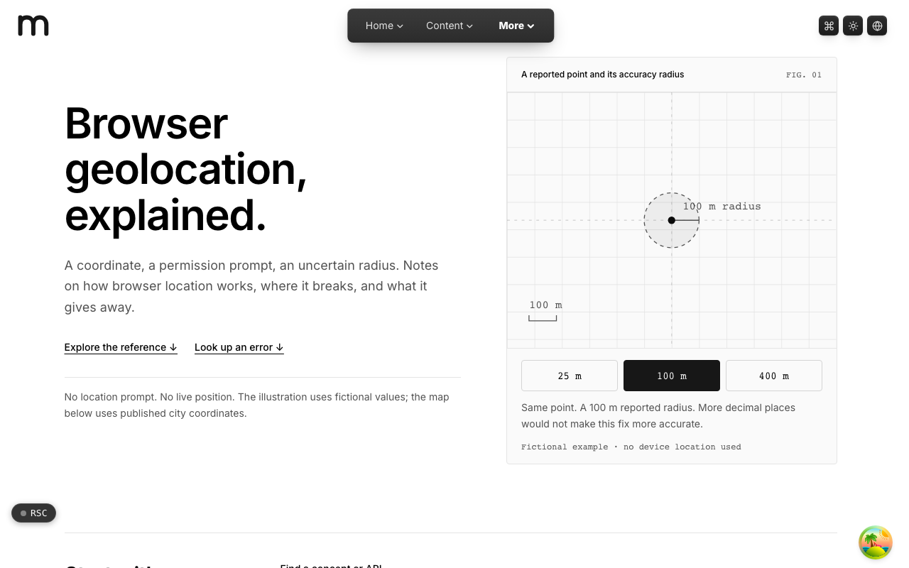
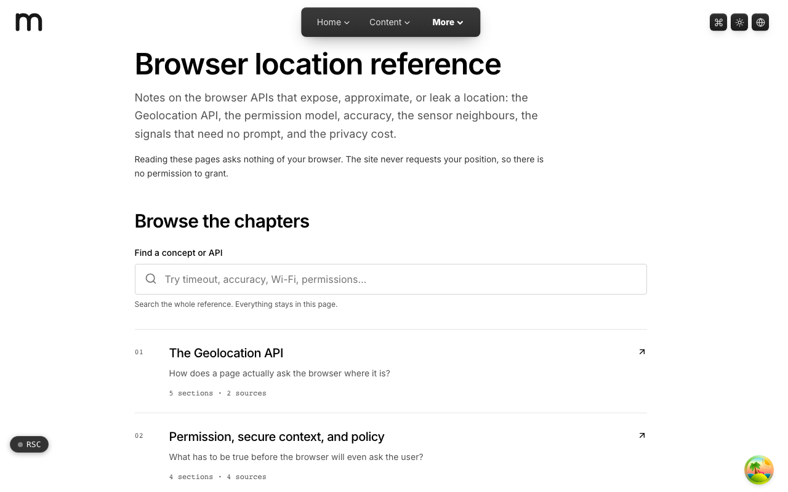

  <picture>
    <source media="(prefers-color-scheme: dark)" srcset=".github/assets/hero-dark.png">
    
  </picture>

# locate.me.at

Browser geolocation, explained.

locate.me.at is an educational field guide to browser geolocation and the location-adjacent web APIs: a coordinate, a permission prompt, an uncertain radius. It explains how browser location works, where it breaks, and what it gives away, for developers who want to use these APIs carefully. Reading it never calls the location or motion APIs, and visitors are never located.

**Live:** [locate.me.at](https://locate.me.at)

## Features

- **Six sourced chapters**: the Geolocation API, permissions and secure context, accuracy, orientation and motion, coarse signals, and the privacy cost.
- **Local reference search**: find a concept or API across every section, entirely in the page.
- **Error quick reference**: look up a geolocation error code from the homepage, read straight from the API chapter.
- **An accuracy illustration**: an interactive figure with fictional radii that makes location uncertainty tangible without using your device.
- **A worked map example**: a small MapLibre map that displays known, city-level coordinates from a self-hosted PMTiles archive.
- **No location prompt**: the site never requests a visitor's position, so there is no permission to grant.

## Screenshots

<table>
  <tr>
    <td width="50%"><picture><source media="(prefers-color-scheme: dark)" srcset=".github/assets/reference-dark.png"></picture> Reference: the browser location chapters, with search.</td>
  </tr>
</table>

## Built with

- Next.js 16 (App Router), React 19, TypeScript
- Tailwind CSS 4
- MapLibre GL with a self-hosted PMTiles archive
- Server-rendered TypeScript content (no MDX pipeline)

## Part of the me.at family

locate.me.at is one of the [`*.me.at`](https://me.at) apps by Trevor McDougald. They share one design system, account, and app shell. Development happens in a private monorepo; this repository is the project's public-facing home.

## License

See [LICENSE](LICENSE).
